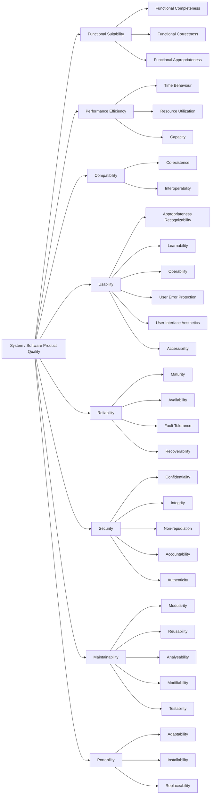

[](https://github.com/seahal/umaxica-apps-cosmos-access/actions/workflows/ci.yml)


# Umaxica Apps Cosmos Access

## Routing

- `auth`: the credential gateway for the App and Org authentication realms.
- `visa`: the OpenID Provider (OP), including discovery, JWKS, authorization, token, and
  browser-bound authority flows for those realms.
- `mission`, `flipper`, `blazer`, `pghero`, `swagger`, and `coverband`: development operations tools
  on their own host-constrained routes.

This Rails process draws only Auth, Visa, and those six development tools. It has no relying-party
(RP) surface; unregistered and retired hosts receive the non-disclosing JSON 404. OIDC client
registrations for RPs in other repositories remain part of Access's OP configuration.

## Stack

### Backend

- Ruby on Rails (`8.2.x`, pre-release)
- Podman services for local infrastructure
- Storage: PostgreSQL (with Solid Queue), Valkey/Redis

### Frontend

- Two coexisting frontend approaches: Inertia Rails (React) and Rails' own default Vite Rails +
  Stimulus + Turbo stack
- Tailwind CSS via Vite, Propshaft for static assets
- Vite and Bun for JavaScript build, linting, formatting, and tests

### Infrastructure

- Dev: FakeCloud
- Test: N/A
- Prod: N/A
- CI: GitHub Actions
- CD: N/A

## Frontend and Assets

UI implementation should treat the Digital Agency of Japan Design System introduction as reading
before inventing screen patterns. Start at
[the introduction](https://design.digital.go.jp/dads/introduction/) and
`docs/reference/digital-agency-design-system.md`. This application's primitives remain in
`src/components/ui/` and `docs/design.md`.

- JavaScript entrypoints are bundled through Vite Rails from `src/entrypoints`.
- Stimulus controllers live in `src/controllers`.
- JavaScript tests live in `gait/` and run directly with Vitest.
- Browser CSS is one Vite stylesheet per surface under `src/styles/surfaces/`; each imports the
  shared token and base layers (`src/styles/theme.css`, `src/styles/base.css`).
- Static non-browser assets are served by Propshaft.

Useful commands:

```bash
bin/dev                         # Web, Vite, and jobs
bin/rails assets:precompile     # Production asset build
bin/rails vite:build            # Vite frontend build
bin/rails assets:clobber        # Remove compiled assets
```

## Local Setup

- Docker Compose, or rootless Podman with `podman-compose`
- Ruby `4.0.x`
- Bundler
- Node.js `24.20.0` (pinned in `.node-version`; `package.json` accepts `>=24.19.0 <25`)
- Bun `1.4.0`

### Credentials and secrets

`config/credentials/development.key`, `config/credentials/test.key`, and the repository-root `.env`
are not tracked in git. Obtain the two key files from the development lead; without them the
application cannot boot and `bin/rails test` cannot run. Credentials for AWS, Cloudflare, Fastly,
and other providers — staging, production, or an individual environment — are also requested from
the development lead and are never committed.

See `docs/operations/development-credential-provisioning.md` for the full procedure. For the
complete portable configuration contract, see `docs/operations/global-portability.md`.
`.env.container.devcontainer` contains the non-secret local defaults that
`.devcontainer/compose.yaml` loads into `core`. Every process, whatever its runtime role, reads the
Rails-standard `config/credentials/<env>.yml.enc`; there are no per-role credential bundles.

### The Bun toolchain

The development image provides the pinned Bun runtime declared by `package.json#packageManager`. Do
not install a second JavaScript package manager inside the container — a second copy on `PATH` makes
which tool ran depend on shell state.

`package.json#packageManager` declares the Bun version expected by the project and CI. Keep that pin
aligned with the Bun toolchain copied into the development and asset images. Corepack is not used,
and no `corepack enable` step is required.

A fresh clone needs no local file. Start the standard stack, install dependencies, and boot the app:

```bash
git clone https://github.com/seahal/umaxica-apps-cosmos-access.git
cd umaxica-apps-cosmos-access

# creating a local override is NOT required
docker compose config     # resolves as-is

docker compose up
bundle install
bun install --frozen-lockfile
bin/setup
```

`compose.yaml` owns shared infrastructure. Rails runs only in the Dev Container:
`.devcontainer/compose.yaml` adds `core`, and the same three commands above are run by hand inside
`core` — `devcontainer.json` declares no `postCreateCommand`, so creating the container neither
fetches dependencies nor touches a database. Running Rails directly on the host is not supported.
`compose.override.yaml` is the only other root Compose file. It is **untracked and gitignored**
(since 2026-09-14), auto-discovered by a bare `podman compose`, and everything in it is
profile-gated: it carries the opt-in `remote-access` Tailscale/sshd overlay of `core` and is where
per-machine settings go. Being untracked is what keeps those settings per-machine; a fresh clone
does not have the file, and does not need it. See the Dev Container startup documentation.

`config/database.yml` fixes the development and test connections to the Compose services: writers
and test databases on `primary`, development replicas on `replica`, port `5432`, user `root`,
password `development`. These are non-secret local values and are not read from the environment. The
production section is intentionally unconfigured. Production boot fails with an explicit
missing-database error until an owner selects a provider.

WebAuthn uses one RP ID and one exact origin per surface (`app` and `org`). Production requires them
as environment variables; other environments read the same variables first and fall back to the
encrypted credentials `webauthn.<surface>.rp_id` / `origin`. A missing value raises. The RP ID must
equal the origin host (`app/values/webauthn/relying_party_config.rb`).

```bash
WEBAUTHN_APP_RP_ID  WEBAUTHN_APP_ORIGIN
WEBAUTHN_ORG_RP_ID  WEBAUTHN_ORG_ORIGIN
```

`bin/setup` installs Ruby gems, runs `bun install --frozen-lockfile` and `bin/rails db:prepare`,
clears logs and temp files, then starts `bin/dev` (pass `--skip-server` to stop before that).

If dependencies are already installed, you can start development directly:

```bash
bin/dev
```

`bin/dev` is the unified local entrypoint. It runs `bin/rails db:prepare` unless
`SKIP_DB_PREPARE=1`, then starts:

- `web`: Rails server on port `3000`
- `vite`: `bin/vite dev`
- `jobs`: `bin/jobs start`

## Development URLs

Modern browsers resolve `*.localhost` to `127.0.0.1`, so extra `/etc/hosts` entries are usually not
needed.

Rails listens on port `3000` inside the Dev Container. The container publishes that service to
`127.0.0.1:3001` on the host; PostgreSQL and Valkey are container-network services with no host
publication. Host-native Rails is not supported. See
`docs/operations/development-host-port-exposure.md`.

| Surface        | Development hostnames                                          |
| -------------- | -------------------------------------------------------------- |
| Auth App / Org | `auth.app.localhost`, `auth.org.localhost`                     |
| Visa App / Org | `visa.app.localhost`, `visa.org.localhost`                     |
| Mission        | `mission.core.dev.localhost`, `mission-access.umaxica.dev`     |
| Flipper        | `flipper.core.dev.localhost`, `flipper-access.umaxica.dev`     |
| Blazer         | `blazer.core.dev.localhost`, `blazer-access.umaxica.dev`       |
| PgHero         | `pghero.core.dev.localhost`, `pghero-access.umaxica.dev`       |
| Swagger        | `swagger.core.dev.localhost`, `swagger-access.umaxica.dev`     |
| Coverband      | `coverband.core.dev.localhost`, `coverband-access.umaxica.dev` |

Use port `3000` from inside the container and host port `3001` from the host. The `.umaxica.dev`
tool aliases are development-container host aliases; live edge routing is managed separately.

## Code Quality

This project organizes code quality around the ISO/IEC 25010 System / Software Product Quality
model. The `Linting and Formatting` / `Testing` / `Security and Quality Checks` sections below each
correspond to concrete, operational means of supporting these quality characteristics.



## Linting and Formatting

```bash
bundle exec rubocop
bundle exec rubocop -a
bundle exec erb_lint .
bundle exec erb_lint -a .
bun run check
bun run fix
```

Use `rubocop -a`, `erb_lint -a .`, and `bun run fix` to apply auto-fixes where available.

## Testing

### Rails Tests

```bash
bundle exec rails test
COVERAGE=true bundle exec rails test test/
```

Rails generates a Valkey test-run namespace when one is not supplied. Coverage reports are written
to `coverage/`. Set `PARALLEL_WORKERS=1` for a focused run when diagnosing a failure.

### JavaScript Tests

Run JavaScript tests with Vitest:

```bash
bun run test
bun run test:watch                            # Watch mode
bun run test:coverage
```

JavaScript tests are located in `gait/` and use Vitest. Coverage reports are written under
`coverage/vite/`.

## Security and Quality Checks

```bash
bundle exec brakeman --no-pager
bundle exec bundler-audit check --update
bun audit
bundle exec debride
```

`debride` is configured for Rails-aware analysis and can also be scoped to specific paths:

```bash
bundle exec debride app/services
DEBRIDE_MINIMUM=5 bundle exec debride
```

## Logging

Application logging is structured. Prefer event-style logging over ad hoc `Rails.logger` calls when
adding domain events or operational signals.

```ruby
Rails.event.notify("user.created", user_id: user.id)
Rails.event.tagged("auth") { Rails.event.notify("login.success", user_id: user.id) }
```

## Pre-commit Checks

Run the Lefthook pre-commit checks before committing:

```bash
lefthook run pre-commit
```

The pre-commit hook formats staged files with oxfmt, autocorrects them with oxlint and RuboCop, and
compiles every ERB template when a view changed. The pre-push hook runs `bun run ci` (JavaScript
checks, Vitest with coverage, and the production build). Security audits and the full Rails suite
run in CI, not in the hooks.

## Troubleshooting

| Problem                                  | Fix                                                                          |
| :--------------------------------------- | :--------------------------------------------------------------------------- |
| Tailwind changes are not reflected       | Run `bin/rails assets:clobber` and restart `bin/dev`                         |
| Tests fail because databases are missing | Run `bin/rails db:prepare`                                                   |
| `bin/dev` stops during boot              | Check `PUBLIC_AUTH_*_URL` and database availability                          |
| Credentials cannot be decrypted          | Obtain the key; see `docs/operations/development-credential-provisioning.md` |

## Repository Knowledge Base

See [repository knowledge architecture](docs/reference/repository-knowledge-architecture.md) for
ownership, authority and lifecycle.

- [Specs](specs/README.md): accepted change contracts.
- [ADRs](adr/repository-knowledge-and-agent-harness.md): accepted decisions and their rationale.
- [Docs](docs/index.md): current engineering documentation and durable acceptance checklists.
- [Research](research/README.md): non-authoritative institutional memory and rejected approaches.
- [Plans](plans/README.md): unaccepted proposals and useful planning history.
- `evidence/`: actual observations against a stated revision, not expectations.
- [Manuals](manuals/README.md): user guidance; presence does not mean published.
- `test/`, `gait/`, `e2e/`: Minitest, Vitest and Playwright respectively.

## Acknowledgement

- Secrets must stay in Rails credentials; do not commit plaintext secrets.
- WebAuthn origins are derived from `PUBLIC_AUTH_*_URL`; `TRUSTED_ORIGINS` is additive only.
- Public availability of this repository is not guaranteed permanently.
